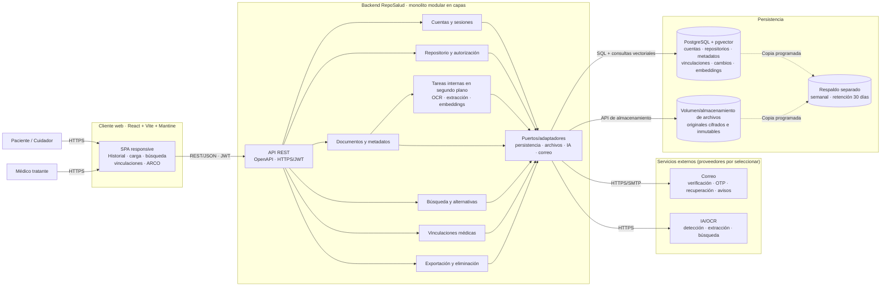
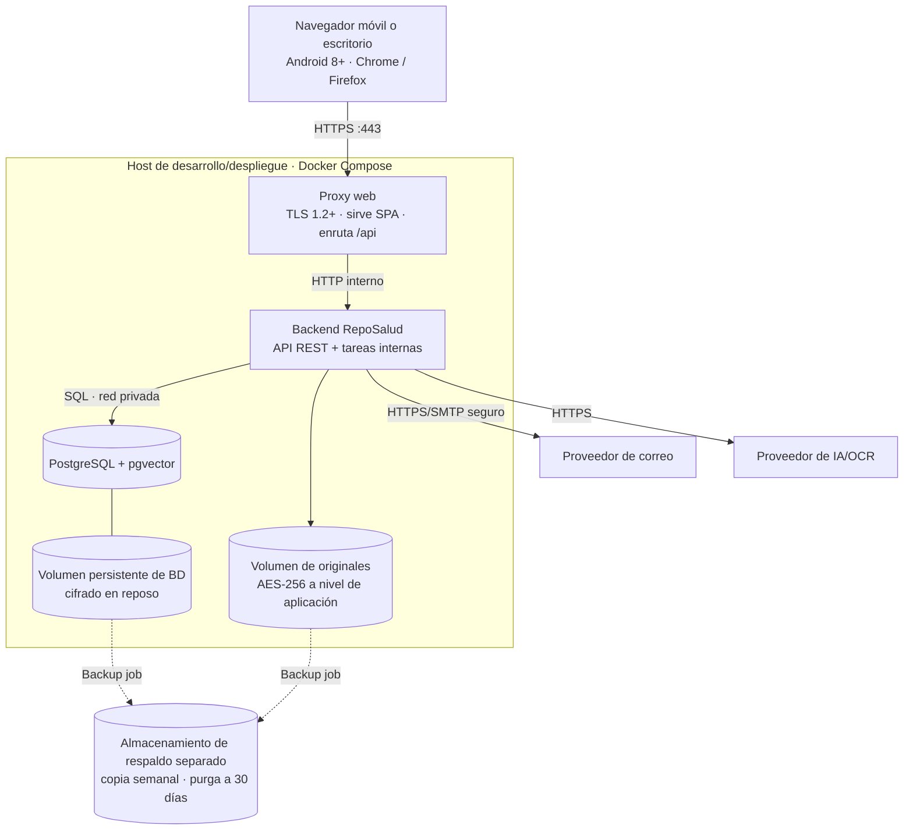

# Arquitectura del equipo — RepoSalud

**Estado:** arquitectura consolidada propuesta a partir de los tres diagramas individuales de componentes y despliegue recibidos, del SRS y de `openapi_equipo.yaml`. La comparación y resolución de diferencias queda registrada en `diferencias_diseno.md`.

## Objetivos y restricciones

- Centralizar documentos médicos sin convertir la aplicación en un expediente clínico institucional ni emitir diagnósticos o recomendaciones.
- Restringir el acceso al repositorio propio o al alcance de una vinculación médica vigente.
- Mantener el archivo original inmutable y protegido; registrar las correcciones de metadatos.
- Permitir que la ingesta y la búsqueda degraden con mensajes claros cuando falle un servicio externo.
- Cumplir la SRS: TLS 1.2 o superior, cifrado AES-256, autorización en servidor, idioma español, accesibilidad y cero datos reales de pacientes en desarrollo/pruebas.

## Estilo arquitectónico propuesto

Un **monolito modular en capas, con puertos y adaptadores en sus límites**. Los módulos se despliegan como una aplicación backend; cada módulo mantiene sus casos de uso y reglas de dominio, mientras que los adaptadores implementan HTTP, persistencia, almacenamiento y servicios externos. Esta decisión integra la arquitectura en capas/monolito modular mayoritaria con la separación hexagonal propuesta por uno de los diagramas, sin introducir microservicios que el MVP no requiere.

La dirección de dependencias va desde los adaptadores HTTP hacia casos de uso y dominio; las entidades de dominio no dependen de FastAPI, de una base de datos ni de proveedores externos. La seguridad se aplica en cada caso de uso antes de consultar o entregar datos, no solo en la interfaz.

## Componentes y responsabilidades

| Componente | Responsabilidad |
| --- | --- |
| Cliente web responsive | Registro, OTP, alta del repositorio, carga y confirmación, historial, búsqueda, visualización, vinculaciones y derechos ARCO. Presenta estados y errores en español. |
| Adaptador REST / OpenAPI | Expone el contrato `openapi_equipo.yaml`, valida payloads, autentica bearer JWT y traduce errores de aplicación a los códigos documentados. |
| Cuentas y sesiones | Registro, verificación de correo, OTP, recuperación de acceso, expiración de sesión y bloqueo temporal por intentos fallidos. |
| Repositorios y autorización | Gestiona cuenta operadora, titular, consentimiento/declaración y preferencias. Evalúa rol, propiedad, vigencia y alcance en cada solicitud. |
| Documentos | Valida JPG/PNG/PDF y límite de 10 MB; registra el original inmutable, hash SHA-256, estado, metadatos y eventos de corrección. |
| Procesamiento de documentos | Extrae texto y sugiere fecha/tipo mediante adaptadores reemplazables. El documento sigue pendiente hasta que el paciente/cuidador confirme. Un fallo no elimina el archivo y habilita captura manual. |
| Búsqueda | Interpreta la consulta para localizar documentos, aplica filtros del repositorio y del alcance médico, conserva el contexto necesario para alternativas, y devuelve documentos en vez de respuestas clínicas. |
| Vinculaciones | Maneja solicitud, aceptación/rechazo, cancelación, vencimiento, revocación, reenvío de aviso y alcance; las transiciones se autorizan por actor y estado. |
| ARCO | Genera el ZIP de exportación y procesa eliminación lógica/solicitud de purga, sin permitir al médico exportar ni eliminar. |
| Persistencia estructurada | Guarda cuentas, repositorios, metadatos, permisos, estados y trazabilidad. Debe soportar consultas por repositorio, filtros y, para búsqueda semántica, una estrategia de índice vectorial compatible. |
| Almacenamiento de archivos | Conserva el archivo cifrado con AES-256 y permite su visualización, descarga autorizada, exportación y purga. El almacenamiento no recibe claves de cifrado en claro. |
| Adaptadores externos | Correo, OCR/extracción y modelos de embeddings/búsqueda. Se pueden sustituir sin cambiar el dominio; deben cumplir RD-04 y no utilizar datos para entrenamiento o cesión a terceros. |

## Diagrama de componentes consolidado

El proceso `jobs` es una responsabilidad interna del backend, no un microservicio ni un contenedor separado en el MVP. Las tareas diferidas no bloquean la carga; el documento permanece pendiente hasta que el usuario confirme fecha y tipo.

## Despliegue lógico de referencia

La elección del proveedor de hosting y de los proveedores externos queda fuera del diagrama lógico. El almacenamiento se consume mediante una interfaz; en el despliegue local usa un volumen cifrado y puede sustituirse por almacenamiento de objetos compatible sin cambiar el dominio.

## Flujos principales

### Carga y confirmación

1. El cliente envía solo el archivo a `POST /repositorios/{repositorioId}/documentos`.
2. El adaptador valida sesión, rol, pertenencia y formato/tamaño. El caso de uso calcula SHA-256 y cifra el original antes de guardarlo.
3. Se crea `Documento` en `pendiente_confirmacion`; el pipeline puede producir sugerencias de fecha/tipo sin bloquear la respuesta de carga.
4. El usuario completa o corrige ambos valores y confirma mediante `PUT .../confirmacion`. Solo entonces el documento se incluye en historial y búsqueda.
5. La corrección posterior usa PATCH y agrega una entrada a `CambioMetadatos`, sin reescribir el archivo.

### Búsqueda

1. El cliente manda `consulta` en JSON a `POST /repositorios/{repositorioId}/busquedas`; la consulta no viaja en la URL.
2. El caso de uso verifica el repositorio y el alcance efectivo del actor antes de consultar índices/metadatos.
3. Se devuelve una coincidencia principal; si la consulta especifica un periodo, se incluyen todos los documentos de ese periodo. Sin coincidencias, se devuelve la lista vacía y el texto exacto de RF-10-AC-7.
4. `GET .../busquedas/{busquedaId}/alternativas` permite recuperar alternativas de la misma búsqueda con la autorización reevaluada.
5. El backend devuelve documentos; no redacta ni interpreta resultados médicos. Una indisponibilidad del servicio de búsqueda se traduce a 503, no a un estado vacío.

### Acceso médico

El paciente/cuidador crea una solicitud con alcance y vigencia. Solo después de que el médico destinatario la acepte queda vigente. En cada listado, consulta de contenido o búsqueda, el backend evalúa estado, vencimiento y alcance; la ruta o el ID del repositorio no conceden permiso por sí mismos. Revocar, cancelar o vencer invalida las solicitudes siguientes.

### Exportación y eliminación

La exportación devuelve un ZIP con originales sin modificar y `resumen.pdf`. Para eliminar el repositorio, la interfaz ofrece exportarlo antes y solicita escribir el nombre del titular; el backend verifica esa confirmación y autoriza solo al paciente/cuidador. Los archivos eliminados se purgan conforme al periodo de 30 días de RNF-20.

## Seguridad y fallos

- Autenticación bearer y autorización por cuenta, rol, repositorio y alcance en cada petición privada.
- TLS 1.2+ en tránsito; cifrado AES-256 en reposo; claves separadas del almacenamiento de archivos.
- Hash SHA-256 para comprobar integridad del archivo durante descarga/exportación.
- Respuestas 401 para sesión/token inválido, 403 para actor sin permiso, 404 para recurso inexistente/eliminado, 413 para archivo mayor a 10 MB y 503 para proveedor externo no disponible, de acuerdo con el SRS.
- Los mensajes no revelan si falló una credencial específica ni exponen contenido médico a logs. Las consultas sensibles se envían en el cuerpo de POST, no en la URL.
- Las pruebas usan únicamente documentos ficticios o anonimizados.

## Decisiones consolidadas y pendientes de proveedor

Para crear los artefactos base se adopta React + Vite + Mantine en el cliente, FastAPI en el backend, PostgreSQL + pgvector para datos estructurados e índice vectorial, y tareas internas en segundo plano para el procesamiento inicial. Se usa un monolito modular en capas, con puertos y adaptadores; el pipeline no se separa como servicio o contenedor hasta que exista una necesidad de escala.

Quedan por seleccionar los nombres concretos de hosting, correo, IA/OCR y almacenamiento de objetos, además del gestor de llaves y la estrategia de retención de las consultas/resultados de búsqueda. Esos proveedores deben cumplir RD-04; las copias de seguridad separadas y semanales deben cumplir RNF-20. La búsqueda persiste el identificador y el contexto mínimo que el API necesita para mostrar alternativas, sujeto a una política de retención que el equipo debe fijar antes de producción.

## Correspondencia con artefactos

- Contrato HTTP: `openapi_equipo.yaml`.
- Modelo de dominio y relaciones persistentes iniciales: `diagrama_clases_equipo.puml`.
- Fuente funcional y de trazabilidad: `S03_A1/SRS_equipo.md`.
- Diferencias y decisiones de consolidación: `diferencias_openapi.md`.
- Comparación de los tres diseños individuales y sus resoluciones: `diferencias_diseno.md`.
